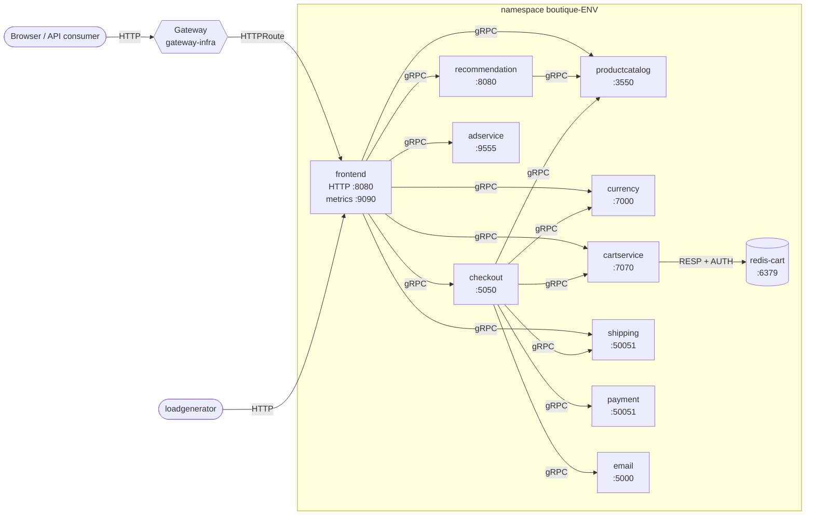
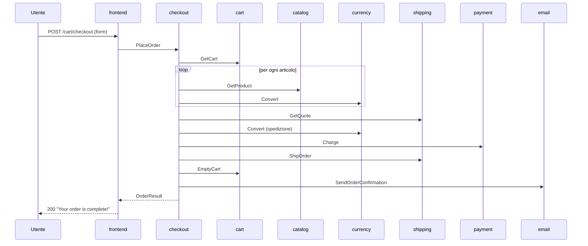

# Architettura

Il documento ha tre livelli: l'**applicazione** (cosa fa Online Boutique e come comunicano i servizi), la **piattaforma** (cosa le gira attorno per rilasciarla ed esercirla) e le **scelte** (perché così, cosa si perde).

## 1. Architettura applicativa

### Mappa sullo schema richiesto dalla challenge

| Ruolo nello scenario | Componente in Online Boutique |
|---|---|
| Client / API consumer | Browser degli utenti e `loadgenerator` (Locust) che simula traffico |
| Ingress / Route | Gateway API: `Gateway` condiviso in `gateway-infra` + `HTTPRoute` per ambiente |
| API service | `frontend` (Go, HTTP): unico punto d'ingresso, orchestra le chiamate gRPC |
| Worker / componente secondario | `checkoutservice` (orchestrazione dell'ordine), `emailservice` (conferma, effetto collaterale), `recommendationservice`, `adservice` (elaborazioni accessorie, non bloccanti) |
| Database / cache | `redis-cart` (stato del carrello) |
| ConfigMap / Secret | Indirizzi dei servizi via env (Kustomize); credenziali Redis nel Secret `redis-auth` |
| CI/CD / GitOps | GitHub Actions (build, test, validazione) + Argo CD (deploy) |
| Monitoring / logging | kube-prometheus-stack (Prometheus, Grafana, kube-state-metrics), log JSON su stdout |
| Krateo | Layer self-service: chart golden path esposto come API `BoutiqueService` |

Online Boutique non ha un worker asincrono con coda: il checkout è **sincrono** (una richiesta HTTP attende sei chiamate gRPC). È un limite di design utile per la discussione: gli errori di email e svuotamento del carrello sono tollerati (solo un warning nei log), mentre la loro *latenza* resta nel percorso della richiesta. Vedi §4.

### Componenti

| Servizio | Linguaggio | Porta | Protocollo | Responsabilità | Dipende da |
|---|---|---|---|---|---|
| frontend | Go | 8080 (Service 80), **9090 metriche** | HTTP | UI web, sessione (cookie), orchestrazione | catalog, currency, cart, recommendation, shipping, checkout, ad |
| productcatalogservice | Go | 3550 | gRPC | Catalogo prodotti (da file JSON) | — |
| currencyservice | Node.js | 7000 | gRPC | Conversione valuta (tassi statici) | — |
| cartservice | C# | 7070 | gRPC | Carrello per sessione | redis-cart |
| redis-cart | Redis | 6379 | TCP/RESP | Store del carrello (`emptyDir`) | — |
| recommendationservice | Python | 8080 | gRPC | Prodotti suggeriti | productcatalog |
| shippingservice | Go | 50051 | gRPC | Preventivo e "spedizione" (tracking fittizio) | — |
| checkoutservice | Go | 5050 | gRPC | Orchestrazione ordine | catalog, cart, currency, shipping, payment, email |
| paymentservice | Node.js | 50051 | gRPC | Addebito simulato su carta | — |
| emailservice | Python | 8080 (Service 5000) | gRPC | Email di conferma (simulata, solo log) | — |
| adservice | Java | 9555 | gRPC | Banner contestuali | — |
| loadgenerator | Python (Locust) | — | HTTP | Traffico sintetico verso il frontend | frontend |

Le dipendenze in tabella sono verificate sulle variabili d'ambiente `*_SERVICE_ADDR` dei manifest, non dedotte dalla documentazione.

### Flussi

**Flusso critico: `POST /cart/checkout`**

Un errore su carrello, catalogo, valuta, preventivo, **pagamento** o **spedizione** diventa un **500 sul frontend per la route `/cart/checkout`**, mentre le altre pagine continuano a funzionare. Gli errori di `EmptyCart` e di `SendOrderConfirmation` invece sono tollerati: l'ordine va comunque a buon fine, con un warning nei log di checkout (verificato in `src/checkoutservice/main.go`, `PlaceOrder`). È esattamente ciò che misurano la metrica `boutique_frontend_http_requests_total{route="/cart/checkout",code="500"}` e l'alert `BoutiqueCheckoutFailing`.

### Stato, configurazione, segreti

- **Stato**: solo `redis-cart`, su `emptyDir`. I dati si perdono al riavvio del pod (scelta upstream, accettabile per un carrello demo; in produzione: Redis gestito o StatefulSet con PVC e replica).
- **Configurazione**: variabili d'ambiente nei manifest (indirizzi dei servizi, `USERS` del load generator, `METRICS_PORT`). Le differenze tra ambienti sono patch Kustomize negli overlay.
- **Segreti**: `redis-auth` (password + connection string per StackExchange.Redis), generato per ambiente da `create-secrets.sh` e mai salvato in Git.

### Punti di estensione

- Componenti Kustomize upstream già pronti: Istio/ASM, Memorystore, Spanner, AlloyDB, Cloud Operations (tracing), `without-loadgenerator`.
- Tracing: tutti i servizi supportano OpenTelemetry (`ENABLE_TRACING`, `COLLECTOR_SERVICE_ADDR`). Basterebbe un collector OTLP con backend Jaeger/Tempo.
- `productCatalogService.extraLatency`: iniezione di latenza, utile per testare l'alert di latenza.

## 2. Architettura di piattaforma

### Responsabilità

| Chi | Possiede | Strumento |
|---|---|---|
| Platform team | Cluster, Gateway, monitoring, policy, AppProject, golden path | `bootstrap.sh` (Helm), Argo CD app `platform-config`, chart Krateo |
| Team applicativo | Overlay del proprio servizio (versione, parametri), codice | PR su Git → Argo CD app `boutique-<env>` |
| CI | Qualità e artefatti (immagini) | GitHub Actions, nessun accesso al cluster |
| Argo CD | Allineamento cluster ↔ Git | Sync automatico, self-heal in prod |

### Flusso di rilascio (GitOps)

1. Il codice cambia, la CI testa e produce l'immagine (in locale: `build-frontend.sh` + `kind load`).
2. Il rilascio è **un commit** che cambia `images[].newTag` nell'overlay (`release.sh`).
3. Argo CD rileva la differenza (polling ogni 60 s o sync esplicito) e applica.
4. Il Deployment fa un rolling update con `maxUnavailable: 0`, `maxSurge: 1` e startup/readiness probe: nessun pod vecchio viene tolto prima che quello nuovo sia pronto.
5. Il rollback è **un `git revert`** (tracciato, revisionabile). `kubectl rollout undo` resta come via d'emergenza documentata.

### Ambienti

| | dev | prod |
|---|---|---|
| Namespace | `boutique-dev` | `boutique-prod` |
| Host | dev.boutique.local | boutique.local |
| Frontend | 1 replica | HPA 2–4 (CPU 80%), PDB `minAvailable: 1` |
| Argo CD | auto-sync, **self-heal off** (si può sperimentare) | auto-sync, **self-heal on** (la deriva viene annullata) |
| Team | operare (restart, rollback, scale, logs, port-forward) | sola lettura; oncall: restart/rollback/scale |
| Carico | 3 utenti Locust | 5 utenti Locust |

Le differenze stanno solo in `overlays/<env>/kustomization.yaml` e nei pochi file accanto. Base e policy sono uguali, così ciò che è testato in dev è ciò che va in prod.

## 3. Scelte tecnologiche e trade-off

| Decisione | Alternative | Perché | Cosa si perde |
|---|---|---|---|
| **Kustomize** sopra il base upstream | Helm chart upstream | Riuso del base senza fork dei template; diff leggibile; supporto nativo Argo CD; validabile offline | Niente "values" parametrici per i consumer → per il self-service si usa un piccolo chart (Krateo) che *genera* l'Application |
| **Argo CD** | Flux | UI utile in demo e in troubleshooting (diff, history, health); AppProject come guardrail | Un componente in più da esercire (~400 MB RAM) |
| **Gateway API** + cloud-provider-kind | ingress-nginx | ingress-nginx è stato ritirato dal progetto Kubernetes (fine manutenzione marzo 2026); Gateway API è lo standard successore; cloud-provider-kind lo implementa in locale senza controller aggiuntivi | Implementazione locale non adatta alla produzione: in un cluster reale si cambia `gatewayClassName` (Envoy Gateway, Istio, cloud LB). Su OpenShift: Route o Gateway API (OCP ≥ 4.19) |
| **kind a nodo singolo** | 1 control-plane + 1 worker, k3d, minikube | Kubernetes upstream; 4 vCPU non giustificano un secondo kubelet | Nessuna demo di scheduling/drain multi-nodo |
| **Metriche frontend con stdlib** | `prometheus/client_golang`, OTel metrics SDK | Diff minimo dall'upstream, `go.mod`/`go.sum` invariati, nessuna nuova dipendenza da verificare | Formato di esposizione scritto a mano (coperto da test): in un prodotto vero si usa la libreria ufficiale |
| **Metriche su porta separata** (9090) | `/metrics` sulla porta pubblica | La HTTPRoute punta solo al Service `frontend:80`: le metriche non sono mai esposte all'esterno | Un Service in più (`frontend-metrics`) |
| **Immagine side-loaded** (`kind load`) | Registry locale, pull da GHCR | Zero credenziali e zero dipendenza dalla rete per la demo; nome e tag identici a quelli che la CI pubblica | Il cluster non verifica la firma o la provenienza dell'immagine |
| **Secret generati da script** | Sealed Secrets, External Secrets + Vault | Nessun componente in più; ogni ambiente ha la sua password casuale | Il Secret non è riconciliato da Git; rotazione manuale ([security](security.md)) |
| **Kyverno** + PSA | Solo PSA, OPA Gatekeeper | PSA copre la sicurezza dei pod (built-in); Kyverno aggiunge governance (owner, tag immutabili) con policy YAML leggibili e PolicyReport | ~400 MB RAM, webhook di ammissione nel percorso critico |
| **Alertmanager disabilitato** | Routing verso Slack/email | Risparmio di risorse; gli alert si leggono in Prometheus `/alerts` | Nessuna notifica push |

## 4. Rischi architetturali dell'applicazione (osservazioni L2)

1. **Checkout sincrono con 6 dipendenze**: la disponibilità del checkout è circa il prodotto delle disponibilità di catalogo, valuta, carrello, spedizione e pagamento. L'email non fa fallire l'ordine, ma è chiamata in modo sincrono: se rallenta, rallenta il checkout, e con un timeout lungo può farlo scadere lato utente. Miglioramento: invio email asincrono tramite coda (outbox pattern).
2. **Liveness = readiness = `/_healthz` statico** sul frontend: il pod è "pronto" anche se i backend non rispondono. È voluto (una readiness legata alle dipendenze causerebbe guasti a cascata), ma significa che **i problemi a valle si vedono solo nelle metriche e nei log**, non nello stato dei pod. Lo scenario `netpol-typo` lo dimostra.
3. **Redis senza persistenza né replica**: single point of failure per il carrello.
4. **Nessun timeout o retry configurato a livello di piattaforma** (niente service mesh): i timeout sono quelli di default dei client gRPC.

## 5. Capacity

Le CPU request upstream valgono circa 1,6 CPU per ambiente (loadgenerator 300m, ad e cart 200m, gli altri 100m, redis 70m). Su un nodo da 4 vCPU con due ambienti, monitoring, Argo CD e Kyverno, lo scheduler lascerebbe pod in `Pending`. Il componente `kind-sizing` porta tutte le CPU request a **20m**, mentre limiti e memoria restano invariati: i pod possono comunque usare CPU libera fino al limite.

È un compromesso da laptop. In produzione le request vanno misurate (p95 di utilizzo reale da Prometheus, VPA in modalità *recommendation*) perché da esse dipendono scheduling, QoS e HPA. In prod il frontend ha la request reimpostata a 100m proprio perché l'HPA calcola l'utilizzo **rispetto alla request**: con 20m scalerebbe sempre al massimo.

Stima della memoria nella VM: Online Boutique circa 1,2–1,5 GB per ambiente, Prometheus + Grafana circa 1–1,5 GB, Argo CD circa 0,4 GB, Kyverno circa 0,4 GB, nodo kind e sistema circa 1,5 GB. In totale 6–7 GB su 10.

## 6. OpenShift (nota)

Il progetto è pensato per Kubernetes vanilla, ma è portabile su OpenShift:
- **Esposizione**: `Route` al posto di Gateway/HTTPRoute (oppure Gateway API, GA da OCP 4.19).
- **Security**: i pod girano già come non-root con `drop: ALL` e seccomp, quindi compatibili con la SCC `restricted-v2`. Va però rimosso `runAsUser: 1000` (o usato un UID nel range del namespace), perché la SCC assegna un UID arbitrario.
- **GitOps**: OpenShift GitOps (Argo CD) con le stesse Application.
- **Monitoring**: *user workload monitoring* al posto di kube-prometheus-stack; ServiceMonitor e PrometheusRule restano validi.
