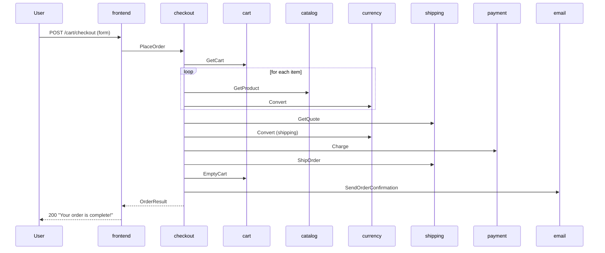
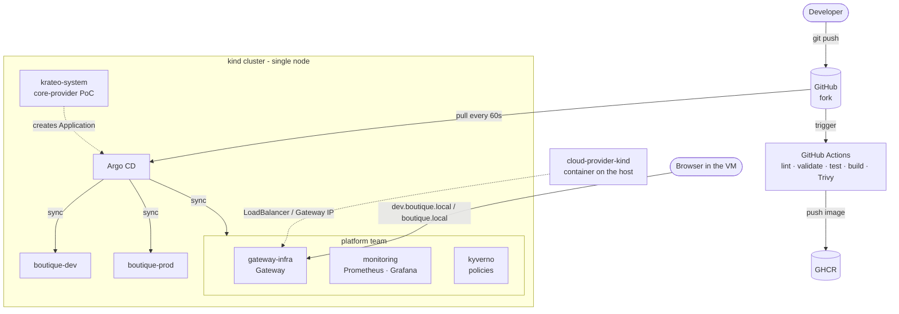

# Architecture

This document has three levels:
1. the **application**: what Online Boutique does and how its services talk to each other;
2. the **platform**: what runs around it to release and operate it;
3. the **choices**: why things are this way, and what we give up.

## 1. Application architecture

### Mapping to the challenge's reference model

| Role in the scenario | Online Boutique component |
|---|---|
| Client / API consumer | Users' browsers and the `loadgenerator` (Locust) that simulates traffic |
| Ingress / Route | Gateway API: shared `Gateway` in `gateway-infra` + one `HTTPRoute` per environment |
| API service | `frontend` (Go, HTTP): the single entry point, orchestrates the gRPC calls |
| Worker / secondary component | `checkoutservice` (order orchestration), `emailservice` (confirmation, side effect), `recommendationservice`, `adservice` (ancillary, non-blocking processing) |
| Database / cache | `redis-cart` (cart state) |
| ConfigMap / Secret | Service addresses via env (Kustomize); Redis credentials in the `redis-auth` Secret |
| CI/CD / GitOps | GitHub Actions (build, test, validation) + Argo CD (deploy) |
| Monitoring / logging | kube-prometheus-stack (Prometheus, Grafana, kube-state-metrics), JSON logs on stdout |
| Krateo | Self-service layer: golden-path chart exposed as a `BoutiqueService` API |

Online Boutique has no asynchronous worker with a queue: checkout is **synchronous**. One HTTP request waits for six gRPC calls. This design limit is worth discussing. Email and cart-emptying errors are tolerated and only logged as a warning, but their *latency* is still on the request path. See §4.

### Components

| Service | Language | Port | Protocol | Responsibility | Depends on |
|---|---|---|---|---|---|
| frontend | Go | 8080 (Service 80), **9090 metrics** | HTTP | Web UI, session (cookie), orchestration | catalog, currency, cart, recommendation, shipping, checkout, ad |
| productcatalogservice | Go | 3550 | gRPC | Product catalog (from a JSON file) | — |
| currencyservice | Node.js | 7000 | gRPC | Currency conversion (static rates) | — |
| cartservice | C# | 7070 | gRPC | Per-session cart | redis-cart |
| redis-cart | Redis | 6379 | TCP/RESP | Cart store (`emptyDir`) | — |
| recommendationservice | Python | 8080 | gRPC | Suggested products | productcatalog |
| shippingservice | Go | 50051 | gRPC | Shipping quote and "shipment" (fake tracking) | — |
| checkoutservice | Go | 5050 | gRPC | Order orchestration | catalog, cart, currency, shipping, payment, email |
| paymentservice | Node.js | 50051 | gRPC | Simulated card charge | — |
| emailservice | Python | 8080 (Service 5000) | gRPC | Confirmation email (simulated, logs only) | — |
| adservice | Java | 9555 | gRPC | Contextual ads | — |
| loadgenerator | Python (Locust) | — | HTTP | Synthetic traffic to the frontend | frontend |

The dependencies in the table come from the `*_SERVICE_ADDR` environment variables in the manifests. They are not inferred from the documentation.

### Flows

**Critical flow: `POST /cart/checkout`**

An error in cart, catalog, currency, quote, **payment** or **shipping** becomes a **500 on the frontend for the `/cart/checkout` route**, while every other page keeps working. Errors from `EmptyCart` and `SendOrderConfirmation` are tolerated: the order still succeeds, with a warning in the checkout logs (verified in `src/checkoutservice/main.go`, `PlaceOrder`). This is exactly what the metric `boutique_frontend_http_requests_total{route="/cart/checkout",code="500"}` and the `BoutiqueCheckoutFailing` alert measure.

### State, configuration, secrets

- **State**: only `redis-cart`, on `emptyDir`. Data is lost when the pod restarts. This is the upstream choice, acceptable for a demo cart. In production: managed Redis, or a StatefulSet with a PVC and replication.
- **Configuration**: environment variables in the manifests (service addresses, the load generator's `USERS`, `METRICS_PORT`). Differences between environments are Kustomize patches in the overlays.
- **Secrets**: `redis-auth` (password + connection string for StackExchange.Redis). `create-secrets.sh` generates it per environment, and it is never stored in Git.

### Extension points

- Upstream Kustomize components ready to use: Istio/ASM, Memorystore, Spanner, AlloyDB, Cloud Operations (tracing), `without-loadgenerator`.
- Tracing: every service supports OpenTelemetry (`ENABLE_TRACING`, `COLLECTOR_SERVICE_ADDR`). An OTLP collector with a Jaeger/Tempo backend would be enough.
- `productCatalogService.extraLatency`: latency injection, useful to test the latency alert.

## 2. Platform architecture

### Responsibilities

| Who | Owns | Tool |
|---|---|---|
| Platform team | Cluster, Gateway, monitoring, policies, AppProjects, golden path | `bootstrap.sh` (Helm), Argo CD app `platform-config`, Krateo chart |
| Application team | Its service overlay (version, parameters), code | PR to Git → Argo CD app `boutique-<env>` |
| CI | Quality and artifacts (images) | GitHub Actions, no cluster access |
| Argo CD | Keeping cluster and Git aligned | Automatic sync, self-heal in prod |

### Release flow (GitOps)

1. The code changes; CI tests it and produces the image. Locally: `build-frontend.sh` + `kind load`.
2. A release is **a commit** that changes `images[].newTag` in the overlay (`release.sh`).
3. Argo CD detects the difference (polling every 60 s, or an explicit sync) and applies it.
4. The Deployment does a rolling update with `maxUnavailable: 0`, `maxSurge: 1` and startup/readiness probes. No old pod is removed before the new one is ready.
5. A rollback is **a `git revert`**: tracked and reviewable. `kubectl rollout undo` remains as a documented emergency path.

### Environments

| | dev | prod |
|---|---|---|
| Namespace | `boutique-dev` | `boutique-prod` |
| Host | dev.boutique.local | boutique.local |
| Frontend | 1 replica | HPA 2–4 (CPU 80%), PDB `minAvailable: 1` |
| Argo CD | auto-sync, **self-heal off** (experiments allowed) | auto-sync, **self-heal on** (drift is reverted) |
| Team | operate (restart, rollback, scale, logs, port-forward) | read-only; on-call: restart/rollback/scale |
| Load | 3 Locust users | 5 Locust users |

The differences live only in `overlays/<env>/kustomization.yaml` and the few files next to it. Base and policies are identical, so what is tested in dev is what goes to prod.

## 3. Technology choices and trade-offs

| Decision | Alternatives | Why | What we give up |
|---|---|---|---|
| **Kustomize** on top of the upstream base | Upstream Helm chart | Reuses the base without forking templates; readable diff; native Argo CD support; can be validated offline | No parametric "values" for consumers → for self-service a small chart (Krateo) *generates* the Application |
| **Argo CD** | Flux | The UI helps in the demo and in troubleshooting (diff, history, health); AppProjects as guardrails | One more component to operate (~400 MB RAM) |
| **Gateway API** + cloud-provider-kind | ingress-nginx | ingress-nginx was retired by the Kubernetes project (end of maintenance March 2026); Gateway API is the standard successor; cloud-provider-kind implements it locally without extra controllers | The local implementation is not production-grade: on a real cluster you change `gatewayClassName` (Envoy Gateway, Istio, cloud LB). On OpenShift: Route, or Gateway API (OCP ≥ 4.19) |
| **Single-node kind** | 1 control plane + 1 worker, k3d, minikube | Upstream Kubernetes; 4 vCPU do not justify a second kubelet | No multi-node scheduling/drain demo |
| **Frontend metrics with the stdlib** | `prometheus/client_golang`, OTel metrics SDK | Minimal diff from upstream, `go.mod`/`go.sum` unchanged, no new dependency to vet | Hand-written exposition format (covered by tests): a real product would use the official library |
| **Metrics on a separate port** (9090) | `/metrics` on the public port | The HTTPRoute only targets the `frontend:80` Service: metrics are never exposed outside | One more Service (`frontend-metrics`) |
| **Side-loaded image** (`kind load`) | Local registry, pull from GHCR | No credentials and no network dependency for the demo; same name and tag CI publishes | The cluster does not verify image signature or provenance |
| **Script-generated Secrets** | Sealed Secrets, External Secrets + Vault | No extra components; each environment gets its own random password | The Secret is not reconciled from Git; manual rotation ([security](security.md)) |
| **Kyverno** + PSA | PSA only, OPA Gatekeeper | PSA covers pod security (built-in); Kyverno adds governance (owner, immutable tags) with readable YAML policies and PolicyReports | ~400 MB RAM, an admission webhook on the critical path |
| **Alertmanager disabled** | Routing to Slack/email | Saves resources; alerts are read in Prometheus `/alerts` | No push notifications |

## 4. Application architecture risks (L2 observations)

1. **Synchronous checkout with 6 dependencies.** Checkout availability is roughly the product of the availability of catalog, currency, cart, shipping and payment. Email does not fail the order, but it is called synchronously: if it slows down, checkout slows down, and with a long timeout the request can expire on the user side. Improvement: asynchronous email through a queue (outbox pattern).
2. **Liveness = readiness = static `/_healthz`** on the frontend. The pod is "ready" even when the backends do not answer. This is intentional, because a dependency-based readiness would cause cascading failures. It means that **downstream problems show only in metrics and logs**, not in pod status. The `netpol-typo` scenario demonstrates it.
3. **Redis without persistence or replication**: single point of failure for the cart.
4. **No timeouts or retries configured at platform level** (no service mesh): timeouts are the gRPC client defaults.

## 5. Capacity

Upstream CPU requests add up to about 1.6 CPU per environment: loadgenerator 300m, ad and cart 200m, the others 100m, redis 70m. A 4 vCPU node also runs two environments, monitoring, Argo CD and Kyverno, so the scheduler would leave pods `Pending`. The `kind-sizing` component sets every CPU request to **20m**. Limits and memory are unchanged, so pods can still use free CPU up to their limit.

Two safeguards keep this density workable, both added after the first real bootstrap froze the VM:
- the kind node container is **capped at vCPUs − 1** (`bootstrap.sh`, `KIND_NODE_CPUS` to override), so the host desktop and Docker always keep one CPU;
- every probed service has a **startup probe** (`kind-sizing`): with 20m requests, cold starts under contention exceed the upstream liveness windows, and the resulting restart loops kept the node CPU-bound.

This is a laptop compromise. In production, requests must be measured: the p95 of real usage from Prometheus, or VPA in *recommendation* mode. Scheduling, QoS and the HPA all depend on them. In prod the frontend request is set back to 100m precisely because the HPA computes utilization **relative to the request**: with 20m it would always scale to the maximum.

Memory estimate in the VM:

| Component | Estimate |
|---|---|
| Online Boutique, per environment | ~1.2–1.5 GB |
| Prometheus + Grafana | ~1–1.5 GB |
| Argo CD | ~0.4 GB |
| Kyverno | ~0.4 GB |
| kind node + system | ~1.5 GB |
| **Total** | **6–7 GB out of 10** |

## 6. OpenShift (note)

The project targets vanilla Kubernetes but can be ported to OpenShift:
- **Exposure**: a `Route` instead of Gateway/HTTPRoute, or Gateway API (GA since OCP 4.19).
- **Security**: pods already run as non-root with `drop: ALL` and seccomp, which fits the `restricted-v2` SCC. However, `runAsUser: 1000` must be removed (or set to a UID in the namespace range), because the SCC assigns an arbitrary UID.
- **GitOps**: OpenShift GitOps (Argo CD) with the same Applications.
- **Monitoring**: *user workload monitoring* instead of kube-prometheus-stack; ServiceMonitors and PrometheusRules stay valid.
