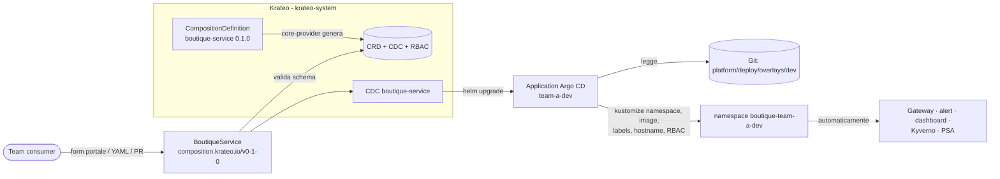

# Krateo: valutazione, blueprint e PoC

> Sintesi: Krateo è adatto a rendere Online Boutique **un servizio self-service con un'API Kubernetes vera** (il "golden path"). La PoC mostra il meccanismo centrale con il solo core-provider. **Raccomandazione:** fare un pilota con 1–2 team, non adottarlo subito come portale aziendale. I motivi sono in §6.

## 1. Cosa è Krateo (per quanto serve qui)

Krateo PlatformOps è una piattaforma open source (Krateo S.r.l., Verona) per costruire una Internal Developer Platform *Kubernetes-native*. Le parti rilevanti:

| Componente | Ruolo |
|---|---|
| **core-provider** (Krateo Composable Operations) | Prende un **Helm chart con `values.schema.json`** referenziato da una `CompositionDefinition` e genera una **CRD versionata** (gruppo `composition.krateo.io`). Per ogni definizione avvia un controller dedicato |
| **composition-dynamic-controller (CDC)** | Riconcilia le istanze della CRD generata: renderizza il chart con lo `spec` dell'istanza come values e lo applica come release Helm, tenendola allineata |
| **chart-inspector** | Fa un dry-run del chart e dice al CDC quali risorse tocca, così da generare **RBAC minima** per ogni composition |
| **Composable Portal** | Frontend configurabile via CRD: form generati dallo schema, catalogo, viste |
| Altri moduli | FinOps (costi), eventi e audit, autenticazione; `krateoctl` per installazione e upgrade |

Il concetto chiave: **un chart diventa un'API**. Il team consumer non chiede un ticket: crea un oggetto `BoutiqueService` (YAML, Git o form del portale). Lo schema lo valida già all'ammissione, e il controller lo realizza.

Fonti: [docs.krateo.io](https://docs.krateo.io), repository [krateoplatformops/core-provider](https://github.com/krateoplatformops/core-provider). La regola con cui vengono generati gruppo, versione e kind della CRD è stata verificata leggendo il codice (`internal/tools/chart/chart.go`), non dedotta dalla documentazione.

## 2. Cosa diventa golden path

| Elemento della soluzione | Nel golden path? | Perché |
|---|---|---|
| Overlay Kustomize `dev`/`prod` (hardening, PSA, NetworkPolicy, probe, ServiceMonitor, RBAC) | **Sì, è il cuore** | Ogni istanza eredita le stesse garanzie del servizio di riferimento. Il team non può "dimenticare" la sicurezza |
| Application Argo CD | **Sì** (generata dal chart) | Un solo motore di deploy (Argo CD) per istanze manuali e self-service: stessa osservabilità GitOps |
| Gateway, monitoring, policy Kyverno, alert, dashboard | No: **servizi di piattaforma condivisi** | Si applicano in automatico alle nuove istanze (gli alert usano `namespace=~"boutique-.*"`, la dashboard ha il namespace come variabile, le policy selezionano per label) |
| Secret `redis-auth` | No, **prerequisito della piattaforma** (oggi script, domani ExternalSecret nel chart) | I segreti non passano dal form del consumer |
| Pipeline CI e immagine | Per ora no (vedi §4) | |

Il chart è in `platform/krateo/boutique-service/`: **un solo template** (`application.yaml`) e uno **schema** (`values.schema.json`). Volutamente piccolo: tutta la complessità resta negli overlay, già testati.

## 3. Parametri esposti al team consumer

| Parametro richiesto dalla challenge | Nel form? | Campo / derivazione | Motivazione |
|---|---|---|---|
| Nome servizio | ✅ | `service.name` (regex DNS-safe) | |
| Namespace | ❌ derivato | `boutique-<name>-<environment>` | Convenzione imposta: rende possibile il guardrail AppProject `boutique-*`, il selettore degli alert e le policy |
| Ambiente | ✅ | `environment`: `dev` \| `prod` (enum) | Seleziona l'overlay, cioè un intero profilo operativo |
| Risorse | ⚠️ indiretto | `service.tier`: `bronze` \| `silver` \| `gold` → tetto HPA 2/4/6 | Esporre CPU e memoria grezze porta a valori casuali. Il tier è una *taglia* governata dalla piattaforma |
| Ingress | ✅ opzionale | `ingress.host` (default `<name>.<env>.boutique.local`) | |
| Repository | ✅ | `git.repoURL` (solo `https://`), `git.targetRevision` | Consente fork o branch per team; l'AppProject limita comunque i repo ammessi |
| Owner | ✅ | `service.owner` → label `platform.example.com/owner` **e** soggetto delle RoleBinding (`<owner>`, `<owner>-oncall`) | La proprietà diventa permessi, routing degli alert e attribuzione dei costi |
| Tier applicativo | ✅ | `service.tier` | Vedi "Risorse"; usabile anche per SLO e priorità degli alert |
| Versione frontend | ✅ | `frontend.version` (semver) | |
| Progetto Argo CD, namespace di Argo CD | ❌ platform-owned | `argocd.*` | Non devono essere scelti dal consumer |

Lo schema rifiuta gli input non validi prima di ogni deploy. Esempio verificato con `jsonschema` sul file reale: `name: Team_A`, `tier: platinum`, `environment: staging`, `version: latest` e `repoURL: http://…` producono 5 errori.

## 4. Cosa potrebbe orchestrare Krateo oltre ai manifest

| Oggetto | Come | Stato |
|---|---|---|
| **Componenti Kubernetes** | Chart → Application Argo CD → overlay (PoC) | Implementato |
| **Pipeline** | Una composition che crea il repository dal template (Krateo ha blueprint di scaffolding GitHub) e ci mette `platform-ci.yaml` | Blueprint |
| **Database** | Redis gestito al posto di `redis-cart`: il chart crea un claim (Crossplane, ACK, ASO o operatore Redis) e un ExternalSecret con la connection string; l'overlay usa `components/managed-redis` | Blueprint |
| **Servizi esterni** | Registrazione DNS, certificato TLS (cert-manager `Certificate`), monitor esterno: altre risorse nel chart | Blueprint |
| **Risorse cloud** | Qualunque CRD (Crossplane/ACK/ASO) può far parte del chart: Krateo non impone un provider | Blueprint |
| **Costi** | Il label `owner` è già su ogni workload: il modulo FinOps può aggregare per team | Prerequisito soddisfatto |



## 5. PoC

**Cosa c'è:**

| File | Contenuto |
|---|---|
| `platform/krateo/boutique-service/` | Chart golden path (`Chart.yaml`, `values.schema.json`, `templates/application.yaml`) |
| `platform/krateo/krateo/compositiondefinition.yaml` | Registrazione del chart in Krateo |
| `platform/krateo/krateo/composition-example.yaml` | Istanza di esempio (`BoutiqueService` in prod, tier silver) |
| `platform/krateo/appproject-selfservice.yaml` | Guardrail Argo CD per le istanze self-service |
| `platform/scripts/krateo-poc.sh` | `package` → `install` → `status` → `cleanup` |

**Esecuzione:**

```bash
platform/scripts/krateo-poc.sh package      # helm lint + package in platform/krateo/dist/
git add platform/krateo/dist && git commit -m "krateo: package boutique-service 0.1.0" && git push
platform/scripts/krateo-poc.sh install      # core-provider + definition + istanza team-a-dev
platform/scripts/krateo-poc.sh status
```

**Cosa dimostra**: da un oggetto `BoutiqueService` di 15 righe nasce un ambiente completo e conforme in `boutique-team-a-dev`, con le stesse policy e lo stesso monitoring, l'hostname dedicato e l'RBAC del team owner. Il tutto senza che il team scriva un manifest Kubernetes.

**Scelte e semplificazioni:**
- Si installa solo il **core-provider** (con chart-inspector), non tutta la suite PlatformOps: è il componente che rende il chart un'API e sta nella VM. Il portale andrebbe in un'adozione vera.
- Il chart viene servito come `.tgz` dal repository (URL raw di GitHub) per non dover gestire credenziali di registry. In produzione: registry OCI (`helm push … oci://ghcr.io/<org>/charts`).
- Il Secret dell'istanza è creato dallo script (prerequisito di piattaforma).

**Da verificare durante l'esecuzione** (non verificabile senza cluster): che il CDC ottenga da chart-inspector i permessi per creare Application nel namespace `argocd` (risorsa fuori dal namespace dell'istanza) e la resa del form nel portale. Se il primo punto non funziona, l'alternativa è che il chart renderizzi direttamente i manifest (senza Argo CD), perdendo però l'uniformità GitOps.

## 6. Benefici, prerequisiti, limiti, rischi

**Benefici**
- **Self-service con guardrail**: il team ottiene un ambiente in minuti, entro i confini decisi dalla piattaforma (schema, AppProject, policy).
- **API Kubernetes-native**: le richieste sono oggetti versionati, quindi gestibili via GitOps, auditabili e con `kubectl get boutiqueservices -A` come inventario.
- **Riuso degli asset esistenti**: Helm chart e JSON Schema, niente DSL proprietario. Il chart funziona anche senza Krateo (`helm install`), quindi il lock-in è basso.
- **RBAC minima generata** per ogni composition (chart-inspector).
- **Ownership e costi**: il label owner obbligatorio si collega al modulo FinOps.

**Prerequisiti**
- Kubernetes ≥ 1.30 e Helm 3 (core-provider).
- Golden path stabile e testato: qui gli overlay, con CI che li valida.
- Registry OCI per i chart, versionamento semver e processo di rilascio dei chart.
- Identity provider (OIDC) per portale e gruppi RBAC.
- Gestione dei segreti automatica (External Secrets), altrimenti il self-service si ferma al Secret.
- Ownership chiara del platform team su chart, schema e upgrade di Krateo.

**Limiti**
- Una composition è "un chart renderizzato": la logica condizionale complessa resta nei template Helm, che diventano difficili da mantenere se crescono.
- **Evoluzione dello schema**: ogni versione del chart genera una nuova versione della CRD. Le migrazioni delle istanze esistenti vanno pianificate (Krateo documenta strategie *full*, *parallel* e *selective*), con un costo operativo reale.
- Doppio livello in questa PoC (Krateo → Helm → Argo CD → Kustomize): potente ma con più punti di diagnosi. Il runbook dovrebbe coprire anche `kubectl get boutiqueservice -o yaml` (condizioni) e i log del CDC.
- Prodotto con community più piccola di Backstage o Crossplane: meno risposte pronte, più dipendenza dal vendor per il supporto.

**Rischi**
- **Il portale diventa il prodotto**: senza manutenzione del golden path, il self-service rilascia debito tecnico in serie.
- **Webhook e controller nel percorso critico**: un guasto di core-provider o del CDC blocca creazione e modifica delle istanze (non quelle già in esecuzione, che restano gestite da Argo CD).
- **Duplicazione con strumenti esistenti** (Backstage, Crossplane, ServiceNow): serve una decisione su chi è la "porta d'ingresso".
- **Permessi del CDC**: se il chart crea risorse in namespace condivisi (qui `argocd`), va verificato con attenzione cosa può fare il controller.

## 7. Raccomandazione: se, quando, come

| Fase | Quando | Cosa | Criterio di uscita |
|---|---|---|---|
| **PoC** (questa) | Ora | core-provider + 1 chart + 1 istanza | Istanza creata e conforme; tempo da richiesta a servizio misurato |
| **Pilota** | Quando ≥ 2 team chiedono ambienti simili, o quando i ticket "creami un namespace o ambiente" diventano un collo di bottiglia | Portale + OIDC + External Secrets + registry OCI; 1–2 team reali; SLO sul tempo di provisioning | Lead time, numero di ticket evitati, NPS dei team, incidenti causati dal golden path |
| **Adozione** | Dopo il pilota, se i criteri sono raggiunti | Catalogo con più golden path (servizio web, worker, DB gestito), FinOps per owner, processo di versionamento dei chart | — |

**Perché non subito:** oggi c'è **un solo servizio** e **un solo team**. Il costo di un portale (installazione, upgrade, OIDC, schema versioning, formazione) supererebbe il beneficio. La PoC dimostra che *il meccanismo funziona* e che gli asset prodotti (overlay, schema, label di ownership, AppProject) sono **già nella forma giusta** per adottarlo quando conviene. Questo è il punto: preparare la piattaforma in modo che Krateo sia un'aggiunta, non una riscrittura.
