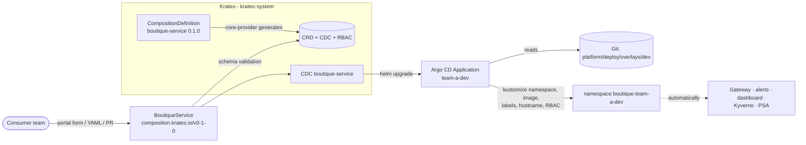

# Krateo: evaluation, blueprint and PoC

> **Summary**
> - Krateo is a good fit to turn Online Boutique into **a self-service offering with a real Kubernetes API** (the "golden path").
> - The PoC demonstrates the core mechanism using core-provider alone.
> - **Recommendation:** run a pilot with 1–2 teams; do not adopt it right away as a company-wide portal. Reasons in §6.

## 1. What Krateo is (as far as it matters here)

Krateo PlatformOps is an open-source platform (Krateo S.r.l., Verona, Italy) for building a *Kubernetes-native* Internal Developer Platform. The relevant parts:

| Component | Role |
|---|---|
| **core-provider** (Krateo Composable Operations) | Takes a **Helm chart with a `values.schema.json`** referenced by a `CompositionDefinition` and generates a **versioned CRD** (group `composition.krateo.io`). Starts one dedicated controller per definition |
| **composition-dynamic-controller (CDC)** | Reconciles instances of the generated CRD: renders the chart with the instance `spec` as values, applies it as a Helm release and keeps it aligned |
| **chart-inspector** | Dry-runs the chart and tells the CDC which resources it touches, so that **least-privilege RBAC** is generated for each composition |
| **Composable Portal** | Frontend configured through CRDs: forms generated from the schema, catalog, views |
| Other modules | FinOps (costs), events and audit, authentication; `krateoctl` for installation and upgrades |

The key concept: **a chart becomes an API**. The consumer team does not open a ticket. It creates a `BoutiqueService` object through YAML, Git or a portal form. The schema validates it at admission, and the controller makes it real.

Sources: [docs.krateo.io](https://docs.krateo.io), the [krateoplatformops/core-provider](https://github.com/krateoplatformops/core-provider) repository. The rule that derives the generated CRD's group, version and kind was verified by reading the code (`internal/tools/chart/chart.go`), not inferred from the documentation.

## 2. What becomes the golden path

| Element of the solution | In the golden path? | Why |
|---|---|---|
| `dev`/`prod` Kustomize overlays (hardening, PSA, NetworkPolicies, probes, ServiceMonitor, RBAC) | **Yes, they are its core** | Every instance inherits the same guarantees as the reference service. A team cannot "forget" security |
| Argo CD Application | **Yes** (generated by the chart) | A single deploy engine (Argo CD) for manual and self-service instances: same GitOps visibility |
| Gateway, monitoring, Kyverno policies, alerts, dashboard | No: **shared platform services** | They apply automatically to new instances: alerts use `namespace=~"boutique-.*"`, the dashboard has the namespace as a variable, policies select by label |
| `redis-auth` Secret | No, a **platform prerequisite** (a script today, an ExternalSecret in the chart tomorrow) | Secrets do not go through the consumer form |
| CI pipeline and image | Not for now (see §4) | |

The chart lives in `platform/krateo/boutique-service/`. It has **a single template** (`application.yaml`) and a **schema** (`values.schema.json`). It is small on purpose: all the complexity stays in the overlays, which are already tested.

## 3. Parameters exposed to the consumer team

| Parameter requested by the challenge | In the form? | Field / derivation | Rationale |
|---|---|---|---|
| Service name | ✅ | `service.name` (DNS-safe regex) | |
| Namespace | ❌ derived | `boutique-<name>-<environment>` | An enforced convention: it enables the `boutique-*` AppProject guardrail, the alert selector and the policies |
| Environment | ✅ | `environment`: `dev` \| `prod` (enum) | Selects the overlay, i.e. a whole operational profile |
| Resources | ⚠️ indirect | `service.tier`: `bronze` \| `silver` \| `gold` → HPA ceiling 2/4/6 | Raw CPU/memory inputs lead to arbitrary values. The tier is a *size* governed by the platform |
| Ingress | ✅ optional | `ingress.host` (default `<name>.<env>.boutique.local`) | |
| Repository | ✅ | `git.repoURL` (`https://` only), `git.targetRevision` | Allows per-team forks or branches; the AppProject still limits the allowed repos |
| Owner | ✅ | `service.owner` → label `platform.example.com/owner` **and** RoleBinding subjects (`<owner>`, `<owner>-oncall`) | Ownership becomes permissions, alert routing and cost attribution |
| Application tier | ✅ | `service.tier` | See "Resources"; can also drive SLOs and alert priority |
| Frontend version | ✅ | `frontend.version` (semver) | |
| Argo CD project, Argo CD namespace | ❌ platform-owned | `argocd.*` | Not for the consumer to choose |

The schema rejects invalid input before any deploy. Example, verified with `jsonschema` against the real file: `name: Team_A`, `tier: platinum`, `environment: staging`, `version: latest` and `repoURL: http://…` produce 5 errors.

## 4. What else Krateo could orchestrate

| Object | How | Status |
|---|---|---|
| **Kubernetes components** | Chart → Argo CD Application → overlay (PoC) | Implemented |
| **Pipelines** | A composition that creates the repository from a template (Krateo has GitHub scaffolding blueprints) and adds `platform-ci.yaml` | Blueprint |
| **Databases** | Managed Redis instead of `redis-cart`: the chart creates a claim (Crossplane, ACK, ASO or a Redis operator) and an ExternalSecret with the connection string; the overlay uses `components/managed-redis` | Blueprint |
| **External services** | DNS registration, TLS certificate (cert-manager `Certificate`), external monitor: more resources in the chart | Blueprint |
| **Cloud resources** | Any CRD (Crossplane/ACK/ASO) can be part of the chart: Krateo does not impose a provider | Blueprint |
| **Costs** | The `owner` label is already on every workload: the FinOps module can aggregate by team | Prerequisite met |



## 5. PoC

**What is included:**

| File | Content |
|---|---|
| `platform/krateo/boutique-service/` | Golden-path chart (`Chart.yaml`, `values.schema.json`, `templates/application.yaml`) |
| `platform/krateo/krateo/compositiondefinition.yaml` | Registers the chart with Krateo |
| `platform/krateo/krateo/composition-example.yaml` | Example instance (`BoutiqueService` in prod, silver tier) |
| `platform/krateo/appproject-selfservice.yaml` | Argo CD guardrail for self-service instances |
| `platform/scripts/krateo-poc.sh` | `package` → `install` → `status` → `cleanup` |

**Running it:**

```bash
platform/scripts/krateo-poc.sh package      # helm lint + package into platform/krateo/dist/
git add platform/krateo/dist && git commit -m "krateo: package boutique-service 0.1.0" && git push
platform/scripts/krateo-poc.sh install      # core-provider + definition + team-a-dev instance
platform/scripts/krateo-poc.sh status
```

**What it demonstrates**: a 15-line `BoutiqueService` object produces a complete, compliant environment in `boutique-team-a-dev`. It gets the same policies and monitoring, a dedicated hostname and the owner team's RBAC. The team writes no Kubernetes manifest.

**Choices and simplifications:**
- Only **core-provider** (with chart-inspector) is installed, not the whole PlatformOps suite. It is the component that turns the chart into an API, and it fits in the VM. A real adoption would add the portal.
- The chart is served as a `.tgz` from the repository (raw GitHub URL), to avoid handling registry credentials. Production: an OCI registry (`helm push … oci://ghcr.io/<org>/charts`).
- The instance Secret is created by the script (platform prerequisite).

**To verify during execution** (not verifiable without a cluster):
- whether the CDC gets the permissions from chart-inspector to create Applications in the `argocd` namespace (a resource outside the instance namespace);
- how the form renders in the portal.

If the first point does not work, the alternative is for the chart to render the manifests directly, without Argo CD. That loses GitOps uniformity.

## 6. Benefits, prerequisites, limits, risks

**Benefits**
- **Self-service with guardrails**: a team gets an environment in minutes, within the boundaries set by the platform (schema, AppProject, policies).
- **Kubernetes-native API**: requests are versioned objects. They can be managed through GitOps, audited, and listed with `kubectl get boutiqueservices -A` as an inventory.
- **Reuse of existing assets**: Helm chart and JSON Schema, no proprietary DSL. The chart also works without Krateo (`helm install`), so lock-in is low.
- **Least-privilege RBAC generated** per composition (chart-inspector).
- **Ownership and costs**: the mandatory owner label connects to the FinOps module.

**Prerequisites**
- Kubernetes ≥ 1.30 and Helm 3 (core-provider).
- A stable, tested golden path: here, the overlays, with CI validating them.
- An OCI registry for charts, semver versioning and a chart release process.
- An identity provider (OIDC) for the portal and the RBAC groups.
- Automated secret management (External Secrets); otherwise self-service stops at the Secret.
- Clear platform-team ownership of the chart, the schema and Krateo upgrades.

**Limits**
- A composition is "a rendered chart": complex conditional logic stays in Helm templates, which become hard to maintain as they grow.
- **Schema evolution**: every chart version generates a new CRD version. Migrating existing instances must be planned (Krateo documents *full*, *parallel* and *selective* strategies), and it has a real operational cost.
- Double layering in this PoC (Krateo → Helm → Argo CD → Kustomize): powerful, but with more places to diagnose. The runbook should also cover `kubectl get boutiqueservice -o yaml` (conditions) and the CDC logs.
- A smaller community than Backstage or Crossplane: fewer ready answers, more reliance on the vendor for support.

**Risks**
- **The portal becomes the product**: without maintenance of the golden path, self-service ships technical debt at scale.
- **Webhooks and controllers on the critical path**: a core-provider or CDC failure blocks creating and changing instances. Running instances are not affected, because Argo CD keeps managing them.
- **Overlap with existing tools** (Backstage, Crossplane, ServiceNow): someone must decide which one is the "front door".
- **CDC permissions**: if the chart creates resources in shared namespaces (here `argocd`), what the controller can do must be checked carefully.

## 7. Recommendation: whether, when, how

| Phase | When | What | Exit criteria |
|---|---|---|---|
| **PoC** (this one) | Now | core-provider + 1 chart + 1 instance | Instance created and compliant; request-to-service time measured |
| **Pilot** | When ≥ 2 teams ask for similar environments, or when "create a namespace/environment for me" tickets become a bottleneck | Portal + OIDC + External Secrets + OCI registry; 1–2 real teams; an SLO on provisioning time | Lead time, tickets avoided, team NPS, incidents caused by the golden path |
| **Adoption** | After the pilot, if the criteria are met | Catalog with more golden paths (web service, worker, managed DB), FinOps by owner, chart versioning process | — |

**Why not right away:** today there is **one service** and **one team**. The cost of a portal (installation, upgrades, OIDC, schema versioning, training) would exceed the benefit. The PoC proves that *the mechanism works* and that the assets produced (overlays, schema, ownership labels, AppProjects) are **already in the right shape** to adopt it when it pays off. That is the point: prepare the platform so that Krateo is an addition, not a rewrite.
